<div align="center">
  

# Companio

**A personal desktop companion for Windows.**

Animated characters, voice and text interaction, and permission-aware desktop automation.

[](https://github.com/Syed-Nazeer-07/companio/actions/workflows/ci.yml)
[](LICENSE)


[Website](https://companio7.vercel.app) · [Download](#download) · [Documentation](#documentation) · [Report an issue](https://github.com/Syed-Nazeer-07/companio/issues/new/choose)

</div>

## Overview

Companio brings a customizable, animated assistant to the Windows desktop. Summon a character with a keyboard shortcut, speak or type a request, and let it handle supported everyday tasks without opening another dashboard.

> **Active preview:** published installers are unsigned. The current release is not a production-certified application. Experimental features and future work are identified separately below.

## Features

| Capability | Current implementation |
| --- | --- |
| Desktop companion | Movable, transparent overlay; character animations, sleep/wake, tray access |
| Voice and text | Push-to-talk, offline English transcription in packaged previews, adjustable speech profiles |
| Windows automation | Supported app and folder launches, volume controls, screenshots and more |
| Web actions | Default-browser searches and bounded managed Edge automation |
| Local intelligence | Built-in command engine; optional Ollama or LM Studio connection |
| Safety | Validated tools, approval for higher-risk or multi-step actions, outcome reporting |
| Personalization | Character Studio, voice settings, history export/restore and optional startup |

### Meet the companions

<div align="center">

     

Sparky · Pixel · Mochi · Cloudie · Kiko · Boba

</div>

Character illustrations are representative artwork, not screenshots of the running application.

## Download

**Current Windows preview: v1.1.0-rc.27**

| Device | Installer |
| --- | --- |
| Snapdragon / Windows on ARM | [ARM64 installer](https://github.com/Syed-Nazeer-07/companio/releases/download/v1.1.0-rc.27/Companio-Setup-1.1.0-rc.27-arm64.exe) |
| Intel / AMD Windows PC | [x64 installer](https://github.com/Syed-Nazeer-07/companio/releases/download/v1.1.0-rc.27/Companio-Setup-1.1.0-rc.27-x64.exe) |

Verify the SHA-256 checksum in the [release notes](https://github.com/Syed-Nazeer-07/companio/releases/tag/v1.1.0-rc.27). Windows may warn about the unsigned publisher. Keep system security protections enabled. See [installation and troubleshooting](docs/user-guide.md) or [all releases](https://github.com/Syed-Nazeer-07/companio/releases).

After installing, press **Ctrl + Shift + Space** to summon Companio. Select a character and use the command bar or microphone.

### Example requests

- Open Calculator.
- Search YouTube for Python DSA.
- Set the volume to 60%.
- Take a screenshot.
- Open Notepad and set volume to 45% (review required).

Basic supported commands do not require an API key or LLM. Generative conversations currently require an optional separately running local model provider; offline speech recognition is a separate capability.

## Build from source

Requirements: Windows 11, Git, Node.js 22 and npm.

```powershell
git clone https://github.com/Syed-Nazeer-07/companio.git
cd companio
npm ci
npm run build
npm start
```

`npm run dev` opens a browser-only interface preview without native Windows actions. Run `npm run test:unit` for automated regression checks.

## Architecture

```text
Voice / text → React companion overlay
                    ↓
            Intent & safety checks
                    ↓
              Electron IPC
                    ↓
    Windows tools / Browser / Optional local AI
                    ↓
             Outcome & local history
```

Built with Electron, React 19, TypeScript, Vite, Tailwind CSS, Framer Motion and Playwright Core. Windows installers use Electron Builder and NSIS; the standalone marketing website is plain HTML, CSS and JavaScript.

## Documentation

| Guide | Contents |
| --- | --- |
| [User guide](docs/user-guide.md) | Voice, local AI, installation and troubleshooting |
| [Development](docs/development.md) | Architecture, scripts, project structure and release verification |
| [Contributing](CONTRIBUTING.md) | Development workflow, tests and reporting |
| [Security](SECURITY.md) | Security reporting, privacy and supported releases |
| [Website](website/README.md) | Static site development and deployment |

## Roadmap

Planned improvements, not current release features:

- Automatic local LLM setup through the installer or settings, without manual server configuration.
- Optional cloud AI with user-provided credentials.
- Improved native click-through, voice recognition and distinct character voices/reactions.
- Refined settings, installer clarity and Windows ARM64 performance.
- Trusted signing and broader real-device validation.

## License

[MIT](LICENSE) · Maintained by [Syed Nazeer S](https://github.com/Syed-Nazeer-07).

Bundled voice components carry their own [third-party notices](build/bundled-voice/NOTICE.md).
